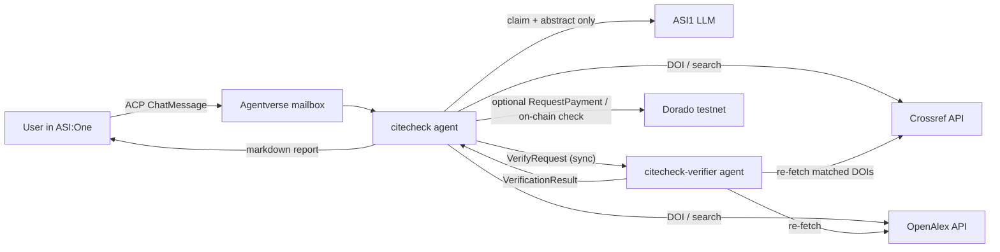

# CiteCheck — verified citation audits for ASI:One


Paste a reference list into ASI:One and get back an evidence-backed audit: which citations are correct,
which have wrong DOIs, years or authors, which can't be found, and whether a paper's abstract supports the
claim you cite it for. A second, independent **Verifier agent** then re-checks the report, and the result of
that check is shown to you.

Built for Fetch-A-Thon 3.0 (IIT Mandi).

| Agent | Role | Address |
|---|---|---|
| `citecheck` | ACP chat agent used from ASI:One (mailbox) | `agent1qg70hvphw3e3x3excsqtasn0mjsz2hmqu8q7eeqcmu8pa68rhuu2kpwue43` |
| `citecheck-verifier` | Independent report verifier (called by `citecheck`) | `agent1qttrf9g8ezyw62vrhqafhdupvxa4j5pgyql2wqemf827m8ug3fgy7ywcjez` |

<!-- Add the Agentverse profile URL and ASI:One shared chat URL here once confirmed. -->

## The problem

Reference lists are easy to get wrong and tedious to check: a DOI pasted from the wrong paper, a
preprint year instead of the publication year, an LLM-suggested citation that doesn't exist, or a paper
cited for something it never says. CiteCheck checks each reference against live scholarly registries and
labels uncertainty instead of guessing.

**Target users:** students, researchers, reviewers and editors checking a bibliography before submission.

## What it does

For each reference (up to 15 per request):

1. **Parses** the reference deterministically: DOI, year, title, first author, and an optional `Claim:`.
2. **Looks it up** in Crossref and OpenAlex (by DOI, or by bibliographic search when no DOI is given).
3. **Compares** the cited title, year, first author and DOI with the registry record, field by field.
4. If the DOI belongs to a different paper, it **searches for the cited title** and reports the correct DOI when it finds one.
5. **Suggests a corrected entry** only for mismatches, built strictly from retrieved metadata.
6. **Checks claim support** with ASI1 using the abstract only. The verdict (`plausible` / `uncertain` /
   `contradicted`) is kept only if the model quotes a passage that literally appears in the abstract;
   otherwise it is downgraded to `uncertain`.
7. **Verifies the report** with the separate Verifier agent (see below).

Per-reference metadata statuses: `verified`, `mismatch`, `doi_not_found`, `not_found` (no confident
match), `insufficient_info`, `lookup_error`.

### Example request (in ASI:One)

```
Verify these references and tell me which need attention:
1. He, K., Zhang, X., Ren, S., & Sun, J. (2014). Deep residual learning for image recognition. CVPR. doi:10.1109/CVPR.2016.90
2. Krizhevsky, A., Sutskever, I., & Hinton, G. (2017). ImageNet classification with deep convolutional neural networks. Communications of the ACM. doi:10.1038/nature14539
3. Jumper, J., et al. (2021). Highly accurate protein structure prediction with AlphaFold. Nature. doi:10.1038/s41586-021-03819-2
   Claim: AlphaFold predictions are far less accurate than experimental structures.
```

Expected outcome (from a live run): #1 year mismatch (2014 → 2016) with a corrected entry; #2 the DOI
belongs to "Deep learning" (LeCun et al.), and the cited paper is found under `10.1145/3065386`; #3 the claim is
**contradicted**, quoting the abstract ("accuracy competitive with experimental structures…").
A larger curated set is in [demo/demo_references.txt](demo/demo_references.txt).

## Architecture



| Module | Responsibility | Deterministic? |
|---|---|---|
| [citecheck/parsing.py](citecheck/parsing.py) | Split input into references, extract DOI/year/title/author/claim | yes |
| [citecheck/sources.py](citecheck/sources.py) | Crossref + OpenAlex clients: timeouts, one retry on 429/5xx, explicit errors | yes |
| [citecheck/compare.py](citecheck/compare.py) | Candidate selection, field comparison, entry formatting | yes |
| [citecheck/assess.py](citecheck/assess.py) | ASI1 claim-support judgment, guarded by a verbatim-quote check | LLM + guard |
| [citecheck/audit.py](citecheck/audit.py) | Orchestration, statuses, counts | yes |
| [citecheck/verify.py](citecheck/verify.py) | Independent quality checks (used by the Verifier agent and the local fallback) | yes |
| [citecheck/payment.py](citecheck/payment.py) | Optional AgentPay pricing and on-chain payment verification | yes |
| [agent.py](agent.py) | ACP chat agent and Payment Protocol (seller) | — |
| [verifier_agent.py](verifier_agent.py) | Verifier agent | — |

### Verifier agent: what "verified" means

`citecheck` sends the user's original text and the full structured report to `citecheck-verifier`, a
separate process with its own identity, using `ctx.send_and_receive(..., sync=True)`. The Verifier:

- re-parses the original input itself and checks that there is exactly one result per reference, bound to the right input;
- recomputes every summary count from the individual records;
- requires an explanation for every unresolved reference;
- checks that each status agrees with its field-level evidence, and recomputes the field checks from the stored source record;
- checks that every suggested correction is exactly the entry derived from the retrieved record;
- requires that every `plausible`/`contradicted` claim verdict carries a source and a quote found in the stored abstract;
- **re-fetches every matched DOI** from Crossref/OpenAlex and compares it with what the report says.

It returns `passed`, `total_checks`, `failed_checks`, `skipped_checks`, `unresolved_references`, `issues`,
`summary` and `verifier` (who actually ran the checks). The tests show it catching deliberately
introduced errors (dropped results, wrong counts, invented corrections, tampered field values, fake quotes).

If the Verifier agent can't be reached, the same checks run locally and the report says
**"Local deterministic verifier (Verifier agent unavailable)"**. A passing result means these defined
checks passed. It does **not** certify that the cited science is correct.

### AgentPay (optional): Payment Protocol

With `PAYMENT_MODE=testnet_fet`, batches of up to `FREE_REFERENCES` (default 3) stay free. Larger batches
are quoted at `PRICE_PER_REFERENCE_FET` (default 0.01) per reference, using the uAgents Payment Protocol
(`RequestPayment` → `CommitPayment` / `RejectPayment` → `CompletePayment` / `CancelPayment`) with
`fet_direct` FET on the **Dorado testnet**: test tokens, **no real money**.

- The audit runs only after the agent finds the transaction on-chain with a transfer of at least the
  quoted amount from the buyer's wallet to the agent's wallet. A `CommitPayment` message alone is not
  treated as proof of payment.
- The check reads the un-merged per-event list from `GetTx`, because cosmpy's `TxResponse.events` merges
  the fee transfer and the payment transfer.
- Transaction IDs can't be reused. Rejected or unverifiable payments run no audit.
- There is no escrow and no refund mechanism, and the agent never claims one.

With `PAYMENT_MODE=off` (the default) every audit is free and the payment protocol is not published.

## Setup

Requires Python 3.10–3.13 (tested on 3.12).

```bash
git clone https://github.com/Nishant-coder-cpu/CiteChecker.git
cd CiteChecker
python3.12 -m venv .venv
source .venv/bin/activate          # Windows: .venv\Scripts\activate
pip install -r requirements.txt
cp .env.example .env               # then fill in ASI_ONE_API_KEY and AGENT_SEED
```

`AGENT_SEED` determines the agent address. Keep it secret, and don't run two copies with the same seed
at once (they would compete for the same mailbox). The Verifier's identity is derived from `AGENT_SEED`,
so no second secret is needed.

## Run

Linux/macOS:

```bash
./run.sh start      # starts the Verifier (port 8002), then CiteCheck (port 8001); logs in logs/
./run.sh status
./run.sh stop
./run.sh restart    # stop + start
```

Any OS, in two terminals:

```bash
python verifier_agent.py
python agent.py
```

On first start, open the "Agent inspector" link printed by `agent.py` and connect the mailbox
(Agentverse → *Connect* → *Mailbox*). The agent is then reachable from ASI:One. Both agents must run on
the same host: the Verifier registers a `127.0.0.1` endpoint.

## Test

```bash
python -m pytest -q tests                                          # 30 offline tests, mocked registries
python verifier_agent.py &                                         # live: real Crossref/OpenAlex/ASI1 + Verifier agent
python scripts/live_e2e.py demo/demo_references.txt demo/last_report.md
python scripts/chat_client.py <citecheck address> demo/demo_references.txt   # live ACP round trip via mailbox
```

The offline suite covers parsing and DOI normalization, lookalike-title rejection, metadata mismatch,
wrong-DOI recovery, missing records, registry timeouts / 429 / 404 / partial outages, malformed and
hallucinated LLM output, missing abstracts, report completeness and counts, verifier tamper detection and
stability, the verifier-unreachable fallback, and payment verification (amount, payer, recipient, denom,
failed or missing transactions).

The agent-to-agent connectivity experiments that informed the design are in
[experiments/a2a/](experiments/a2a/), and their recorded results are in `experiments/a2a/result_*.json`.

## Known limitations

- **Abstracts only.** Claim checks never see the full paper, and many records (e.g. some Nature
  papers) have no abstract in either registry, so those claims are reported as `not assessed`.
- **Registry coverage.** Conference papers without a Crossref DOI (e.g. NeurIPS 2017 "Attention is all you need")
  may get no confident match, because OpenAlex lists it under a 2025 re-upload, and CiteCheck rejects a
  year-mismatched search hit rather than "correcting" toward it. Not found ≠ fake.
- **Heuristic parsing.** Unusual citation styles may lose the title or author. The report then shows
  fewer field checks rather than inventing values.
- **Almanac lookups can stall.** The SDK's lookup gives up after one 5 s request, so CiteCheck uses a
  resolver ([citecheck/resolver.py](citecheck/resolver.py)) that retries, falls back to the last good result,
  and reaches the co-located Verifier at its local endpoint. Replies are checked for delivery and retried once.
- **OpenAlex is sometimes slow or returns 5xx.** Lookups fall back to Crossref, and the report notes the
  outage.
- **Same-host Verifier.** The Verifier uses a localhost endpoint. Cross-machine delivery via Agentverse
  mailboxes was not tested.
- **Payments are testnet-only** and have not been exercised end-to-end with a real ASI:One wallet in
  this repository's tests (the reject and fake-commit paths were tested live with protocol messages).

## Resources

- Crossref REST API: https://api.crossref.org
- OpenAlex API: https://docs.openalex.org
- ASI1 API: https://innovationlab.fetch.ai/resources/docs/asione/asi-one-quickstart
- uAgents / Agent Chat Protocol: https://innovationlab.fetch.ai/resources/docs/intro
- Payment Protocol reference example: https://github.com/fetchai/innovation-lab-examples/tree/main/fet-example
