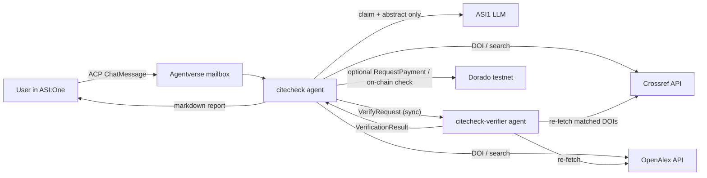

# CiteCheck

**Evidence-backed citation audits for ASI:One**

[](#setup)
[](#test)
[](https://fetch.ai/)
[](#)

Paste a bibliography into ASI:One and CiteCheck checks citations against Crossref and OpenAlex, flags
metadata mismatches, and assesses claims against paper abstracts. An independent Verifier agent then
checks the report's evidence and calculations.

> **Important:** Claim assessments use abstracts, not full papers. A missing registry record does not
> prove a work is fake, and a passing report verification does not certify the underlying scholarship.

## Contents

- [What it checks](#what-it-checks)
- [Try an example](#try-an-example)
- [Architecture](#architecture)
- [Agentic investigation](#agentic-investigation)
- [Report verification](#report-verification)
- [Setup](#setup)
- [Run](#run)
- [Test](#test)
- [Known limitations](#known-limitations)
- [Resources](#resources)

## What it checks

- **Citation metadata:** parses title, author, year, and DOI, then compares them with Crossref and OpenAlex.
- **Wrong or missing DOIs:** looks for the cited work when a DOI points to a different paper; only suggests corrections supported by retrieved metadata.
- **Claim support:** asks ASI1 to assess a claim against the abstract and requires a quote that appears in that abstract for a `plausible` or `contradicted` verdict.
- **Report integrity:** a separate Verifier checks the results, evidence, counts, suggested corrections, and matched DOI records.

Audits support up to **15 references per request**. Metadata outcomes include `verified`, `mismatch`,
`doi_not_found`, `not_found`, `insufficient_info`, and `lookup_error`.

| Agent | Role | Address |
|---|---|---|
| `citecheck` | ACP chat agent used from ASI:One (mailbox) | `agent1qg70hvphw3e3x3excsqtasn0mjsz2hmqu8q7eeqcmu8pa68rhuu2kpwue43` |
| `citecheck-verifier` | Independent report verifier (called by `citecheck`) | `agent1qttrf9g8ezyw62vrhqafhdupvxa4j5pgyql2wqemf827m8ug3fgy7ywcjez` |

**ASI:One demo chat:** https://asi1.ai/chat/e882fc3e-a3b5-4990-ad27-78d3a7905838

**Agentverse profile:** https://agentverse.ai/agents/details/agent1qg70hvphw3e3x3excsqtasn0mjsz2hmqu8q7eeqcmu8pa68rhuu2kpwue43/profile

## Try an example

Paste this into the [CiteCheck ASI:One demo](https://asi1.ai/chat/e882fc3e-a3b5-4990-ad27-78d3a7905838):

```text
Check these citations and tell me whether the claim is supported:
1. He, K., Zhang, X., Ren, S., & Sun, J. (2014). Deep residual learning for image recognition. CVPR. doi:10.1109/CVPR.2016.90
   Claim: Residual connections make it possible to train substantially deeper networks.
2. Jumper, J., et al. (2021). Highly accurate protein structure prediction with AlphaFold. Nature. doi:10.1038/s41586-021-03819-2
   Claim: AlphaFold predictions are far less accurate than experimental structures.
```

The first citation should be flagged for its year; the second claim should be contradicted by the abstract.
For a larger example, see [demo/demo_references.txt](demo/demo_references.txt) or the ten-reference
[demo/large_references.txt](demo/large_references.txt).

## Architecture



| Module | Responsibility | Deterministic? |
|---|---|---|
| [citecheck/parsing.py](citecheck/parsing.py) | Split input into references, extract DOI/year/title/author/claim | yes |
| [citecheck/sources.py](citecheck/sources.py) | Crossref + OpenAlex clients: timeouts, one retry on 429/5xx, explicit errors | yes |
| [citecheck/compare.py](citecheck/compare.py) | Candidate selection, field comparison, entry formatting | yes |
| [citecheck/assess.py](citecheck/assess.py) | ASI1 claim-support judgment, guarded by a verbatim-quote check | LLM + guard |
| [citecheck/audit.py](citecheck/audit.py) | Orchestration, statuses, counts | yes |
| [citecheck/verify.py](citecheck/verify.py) | Independent quality checks (used by the Verifier agent and the local fallback) | yes |
| [citecheck/payment.py](citecheck/payment.py) | Optional AgentPay pricing and on-chain payment verification | yes |
| [agent.py](agent.py) | ACP chat agent and Payment Protocol (seller) | — |
| [verifier_agent.py](verifier_agent.py) | Verifier agent | — |

### Request lifecycle and local demo

Each request follows this path:

1. `agent.py` receives a chat message, or `scripts/live_e2e.py` reads a local input file and calls the same service directly.
2. `citecheck/parsing.py` extracts references and any associated claims.
3. `citecheck/audit.py` queries Crossref and OpenAlex, matches records, compares citation fields, and assesses claims against retrieved abstracts.
4. When enabled, the ASI1 ReAct investigator searches for references the deterministic lookup could not confidently resolve. It can select only records returned by its registry tools; deterministic checks gate its selection.
5. The structured report is sent to the separate Verifier, which checks the input/report binding, counts, field evidence, corrections, claim quotes, investigator evidence, and (when enabled) live DOI lookups. If the remote Verifier is unavailable, the same deterministic checks run locally.
6. If verification finds issues and agentic reflection is enabled, flagged references are audited once more. CiteCheck then renders a Markdown report with the results and verification summary.

| Local process | Entry point | Role | Default port |
|---|---|---|---:|
| CiteCheck chat agent | `agent.py` | Receives ACP requests and returns audit reports through the Agentverse mailbox. | 8001 |
| Verifier agent | `verifier_agent.py` | Independently checks audit reports; exposes a local endpoint for the CiteCheck agent. | 8002 |
| Live demo client | `scripts/live_e2e.py` | Reads an input file, runs the shared service, and writes a UTF-8 Markdown report. | 8000 |

The local demo client calls the request service directly, so it does not need `agent.py` running. Run the Verifier in one terminal and the demo command in another:

```powershell
.\.venv\Scripts\python.exe .\verifier_agent.py
.\.venv\Scripts\python.exe .\scripts\live_e2e.py .\demo\large_references.txt .\demo\last_report.md
```

The Verifier uses a localhost endpoint, so the two long-running agents must run on the same computer. The demo client is temporary and does not expose a public endpoint.

### Agentic investigation

The ReAct investigator and verifier-feedback reflection are enabled with `AGENTIC_MODE=on`.

CiteCheck is a hybrid. A fast deterministic path resolves most references in about a second. When it
can't (no confident match, a DOI that doesn't resolve, or a DOI pointing to a different paper),
a **ReAct investigator** takes over ([citecheck/investigator.py](citecheck/investigator.py)):

- ASI1 runs a **think → act → observe** loop with tool calling (up to 5 steps). Its tools are
  `crossref_search`, `openalex_search`, `lookup_doi` and `conclude`. It decides its own strategy: spelling
  variants, preprint vs. published version, author + year, or checking whether a journal exists at all.
- Every record a tool returns becomes evidence `E<n>`. The agent finishes by naming an evidence id. **It
  cannot supply metadata itself**, so it can't hallucinate a DOI.
- Its choice passes a **deterministic gate** (DOI present, title match, year within one). In a live run
  the agent argued that a 2025 re-upload was the 2017 Transformer paper, and the gate refused it.
- The **Verifier agent** checks that every investigator-identified DOI appears in the agent's own tool
  observations. The full Thought → Action → Observation transcript is shown in the report.
- **Reflection:** if the Verifier agent reports failed checks, the flagged references are re-audited
  once and the report is verified again. Both rounds are reported.

Example from a live run: *"Kingma & Ba (2015). Adam: A method for stochastic optimisation. ICLR."* has
no DOI and a British spelling, so the fast path finds nothing. The agent reasons that ICLR papers lack
Crossref DOIs, searches both registries, identifies the arXiv record `10.48550/arxiv.1412.6980`, and the
reference is verified. Try it with [demo/agentic_references.txt](demo/agentic_references.txt).

Set `AGENTIC_MODE=off` to run the purely deterministic pipeline.

### Report verification

`citecheck` sends the user's original text and the full structured report to `citecheck-verifier`, a
separate process with its own identity, using a signed synchronous agent-to-agent HTTP exchange. The Verifier:

- re-parses the original input itself and checks that there is exactly one result per reference, bound to the right input;
- recomputes every summary count from the individual records;
- requires an explanation for every unresolved reference;
- checks that each status agrees with its field-level evidence, and recomputes the field checks from the stored source record;
- checks that every suggested correction is exactly the entry derived from the retrieved record;
- requires that every `plausible`/`contradicted` claim verdict carries a source and a quote found in the stored abstract;
- **re-fetches every matched DOI** from Crossref/OpenAlex and compares it with what the report says.

It returns `passed`, `total_checks`, `failed_checks`, `skipped_checks`, `unresolved_references`, `issues`,
`summary` and `verifier` (who actually ran the checks). The tests show it catching deliberately
introduced errors (dropped results, wrong counts, invented corrections, tampered field values, fake quotes).

If the Verifier agent can't be reached, the same checks run locally and the report says
**"Local deterministic verifier (Verifier agent unavailable)"**. A passing result means these defined
checks passed. It does **not** certify that the cited science is correct.

### AgentPay (optional): Payment Protocol

With `PAYMENT_MODE=testnet_fet`, batches of up to `FREE_REFERENCES` (default 3) stay free. Larger batches
are quoted at `PRICE_PER_REFERENCE_FET` (default 0.01) per reference, using the uAgents Payment Protocol
(`RequestPayment` → `CommitPayment` / `RejectPayment` → `CompletePayment` / `CancelPayment`) with
`fet_direct` FET on the **Dorado testnet**: test tokens, **no real money**.

- The audit runs only after the agent finds the transaction on-chain with a transfer of at least the
  quoted amount from the buyer's wallet to the agent's wallet. A `CommitPayment` message alone is not
  treated as proof of payment.
- The check reads the un-merged per-event list from `GetTx`, because cosmpy's `TxResponse.events` merges
  the fee transfer and the payment transfer.
- Transaction IDs can't be reused. Rejected or unverifiable payments run no audit.
- There is no escrow and no refund mechanism, and the agent never claims one.

With `PAYMENT_MODE=off` (the default) every audit is free and the payment protocol is not published.

## Observability

Every chat request is traced: each registry lookup, ASI1 call, Verifier exchange and reply delivery is
recorded as a timed span with its outcome, and the whole trace is appended to `logs/traces.jsonl`.
Each report ends with a one-line run summary and its trace id, e.g.
`Run details: Crossref 4 · OpenAlex 4 · ASI1 1 · Verifier agent 1 · total 8.2 s · trace 921aac8b2547`.

```bash
python scripts/trace_summary.py            # outcomes, latency percentiles, per-dependency health
python scripts/trace_summary.py --last 20
```

The traces drove several fixes: OpenAlex 504s were taking about 20 s per lookup because they were being
retried (they no longer are), and stalled connections to Agentverse and ASI1 led to the connect-timeout
policy in [citecheck/net.py](citecheck/net.py).

## Setup

Requires Python 3.10–3.13 (tested on 3.12).

Clone the repository:

```console
git clone https://github.com/Nishant-coder-cpu/CiteChecker.git
cd CiteChecker
```

Create a virtual environment and install dependencies.

**Windows PowerShell**

```powershell
py -3.12 -m venv .venv
.\.venv\Scripts\python.exe -m pip install -r requirements.txt
Copy-Item .env.example .env
notepad .env
```

**Linux/macOS**

```bash
python3.12 -m venv .venv
source .venv/bin/activate
python -m pip install -r requirements.txt
cp .env.example .env
```

In `.env`, set `ASI_ONE_API_KEY` and a private `AGENT_SEED`. The seed determines the agent address;
keep it secret and do not run two copies with the same seed at once, because they would compete for
the same mailbox. The Verifier's identity is derived from `AGENT_SEED`, so no second secret is needed.

## Run

Windows PowerShell:

```powershell
.\run.ps1 start      # starts the Verifier and CiteCheck in the background
.\run.ps1 status
.\run.ps1 logs       # follow both agents' logs
.\run.ps1 stop
.\run.ps1 restart
```

The PowerShell launcher writes logs to `logs/`. Standard output is in
`<agent>.log`; errors are in `<agent>.error.log`. To capture output from agents
already running in terminals, use `.\run.ps1 restart` first; output from before
the restart cannot be recovered.

Linux/macOS:

```bash
./run.sh start      # starts the Verifier (port 8002), then CiteCheck (port 8001); logs in logs/
./run.sh status
./run.sh logs       # follow both agent logs live
./run.sh stop
./run.sh restart    # stop + start
```

Any OS, in two terminals:

```bash
python verifier_agent.py
python agent.py
```

On first start, open the "Agent inspector" link printed by `agent.py` and connect the mailbox
(Agentverse → *Connect* → *Mailbox*). The agent is then reachable from ASI:One. Both agents must run on
the same host: the Verifier registers a `127.0.0.1` endpoint.

### Run the local audit demo

Start both long-running agents with `.\run.ps1 start` (Windows) or `./run.sh start` (Linux/macOS).
Then, in another terminal, run the demo against the ten-reference sample:

```powershell
.\.venv\Scripts\python.exe .\scripts\live_e2e.py .\demo\large_references.txt .\demo\last_report.md
```

The script prints `REPORT_WRITTEN` when the live audit completes. Open the result with
`notepad .\demo\last_report.md`. The audit uses the configured ASI1 API and live scholarly registries.
To try a smaller sample, substitute `.\demo\demo_references.txt`.

## Test

Run the offline tests (registry calls are mocked):

```powershell
.\.venv\Scripts\python.exe -m pytest -q tests
```

For a live service check, start the Verifier first, then run the end-to-end audit command above.
To exercise an ACP chat round trip, start both agents, connect the CiteCheck mailbox in Agentverse,
and run:

```bash
python scripts/chat_client.py <citecheck-address> demo/demo_references.txt
```

The offline suite covers parsing and DOI normalization, lookalike-title rejection, metadata mismatch,
wrong-DOI recovery, missing records, registry timeouts / 429 / 404 / partial outages, malformed and
hallucinated LLM output, missing abstracts, report completeness and counts, verifier tamper detection and
stability, the verifier-unreachable fallback, and payment verification (amount, payer, recipient, denom,
failed or missing transactions).

The agent-to-agent connectivity experiments that informed the design are in
[experiments/a2a/](experiments/a2a/), and their recorded results are in `experiments/a2a/result_*.json`.

## Known limitations

- **Abstracts only.** Claim checks never see the full paper, and many records (e.g. some Nature
  papers) have no abstract in either registry, so those claims are reported as `not assessed`.
- **Registry coverage.** Conference papers without a Crossref DOI (e.g. NeurIPS 2017 "Attention is all you need")
  may get no confident match, because OpenAlex lists it under a 2025 re-upload, and CiteCheck rejects a
  year-mismatched search hit rather than "correcting" toward it. Not found ≠ fake.
- **Heuristic parsing.** Unusual citation styles may lose the title or author. The report then shows
  fewer field checks rather than inventing values.
- **Almanac lookups can stall.** The SDK's lookup gives up after one 5 s request, so CiteCheck uses a
  resolver ([citecheck/resolver.py](citecheck/resolver.py)) that retries, falls back to the last good result,
  and reaches the co-located Verifier at its local endpoint. Replies are checked for delivery and retried once.
- **OpenAlex is sometimes slow or returns 5xx.** Lookups fall back to Crossref, and the report notes the
  outage.
- **Same-host Verifier.** The Verifier uses a localhost endpoint. Cross-machine delivery via Agentverse
  mailboxes was not tested.
- **Payments are testnet-only** and have not been exercised end-to-end with a real ASI:One wallet in
  this repository's tests (the reject and fake-commit paths were tested live with protocol messages).

## Resources

- Crossref REST API: https://api.crossref.org
- OpenAlex API: https://docs.openalex.org
- ASI1 API: https://innovationlab.fetch.ai/resources/docs/asione/asi-one-quickstart
- uAgents / Agent Chat Protocol: https://innovationlab.fetch.ai/resources/docs/intro
- Payment Protocol reference example: https://github.com/fetchai/innovation-lab-examples/tree/main/fet-example
